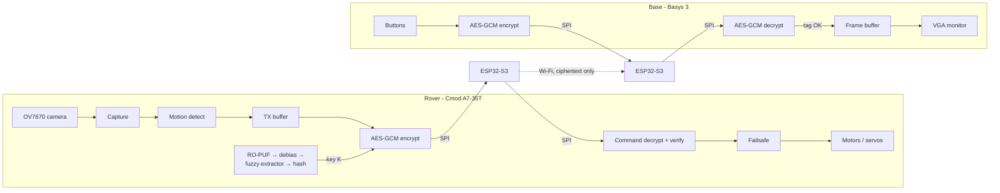

# Secure Reconnaissance Rover on FPGA

An FPGA rover that streams live video over an untrusted wireless link. The video is
encrypted and authenticated with AES-128-GCM in FPGA fabric, and the key comes from an
on-chip ring-oscillator PUF, so it is never stored anywhere.

Graduation project, Computer and Communications Engineering, Faculty of Engineering,
Alexandria University. Verilog / SystemVerilog on Xilinx Artix-7, Python golden models.
Phase 0 (simulation and synthesis) is complete, hardware bring-up is in progress.

## Overview

A reconnaissance rover sends video from places where its radio link may be intercepted, and the rover itself may be hijacked or captured. This project is designed so that an attacker can't watch the feed, can't drive the rover, and can't pull the keys out of a captured board.

All security runs in FPGA hardware. The ESP32-S3 Wi-Fi modules are treated as **untrusted**: they only ever carry ciphertext, and no processor on the rover ever sees plaintext video or keys.

| Threat | Protection |
|---|---|
| Wireless link intercepted | AES-128-GCM encryption of all video |
| Forged commands or hijacking | AES-GCM-authenticated commands with a replay counter |
| Replay of recorded traffic after a reboot | Per-session key derived at boot from fresh nonces from both sides, through an authenticated HELLO exchange |
| Rover captured, keys searched | AES key regenerated from a ring-oscillator **PUF** at power-up and never stored |
| Rover software compromised | Encryption is inline in FPGA fabric, so no CPU handles plaintext |
| Link lost | Motor failsafe stops the rover about 500 ms after the last valid command |
| Traffic analysis | Packet type and motion flag are encrypted, all packets have the same size, and packets go out at a constant rate with encrypted padding |

Known limitations, such as jamming, side-channel and fault attacks, and an attacker loading their own bitstream on a captured board, are documented in [`PROJECT_BRIEF.md`](PROJECT_BRIEF.md).

## System architecture



At boot both sides run an authenticated HELLO exchange and derive a session key `K_s = AES_K(N_rover || N_base)` from fresh nonces produced by an on-chip ring-oscillator TRNG.

## Status

The project is built in phases, and each phase starts only after the previous one passes its acceptance test.

| Phase | Work | Status |
|---|---|---|
| 0 | All cryptographic and security cores, testbenches and Python golden model | **Done**: all tests pass in simulation and synthesis |
| 1 | Camera → VGA on the Basys 3 | Next (needs hardware) |
| 2 | AES-GCM inline in the camera pipeline | Planned |
| 3 | SPI + ESP32-S3 link, HELLO exchange, constant-rate packetizer | Planned |
| 4 | PUF and TRNG on hardware, enrollment bitstream | Planned |
| 5 | Chassis, encrypted commands, failsafe | Planned |
| 6 | Benchmarks and security tests | Planned |

The day-by-day log is in [`docs/progress.md`](docs/progress.md).

## Phase 0 results

### Cores

| Module | What it does |
|---|---|
| `aes128_core` | Iterative AES-128 encryption, one round per clock, on-the-fly key expansion |
| `ghash` | Bit-serial GF(2¹²⁸) multiplier for GCM authentication |
| `aes_gcm` | AES-GCM encrypt/decrypt with tag check, plus an ECB mode so key derivation and TRNG conditioning share the same AES core (saves ~1,300 LUTs per board) |
| `motion_detect` | Frame-difference motion detection on a 320×240 frame buffer |
| `ro_puf`, `puf_debias`, `fuzzy_extractor`, `puf_hash`, `puf_keygen` | Ring-oscillator PUF, von Neumann debiasing, repetition-code fuzzy extractor and Davies–Meyer hash that turn chip variation into a stable key |
| `ro_trng`, `trng_health` | Ring-oscillator TRNG with continuous repetition-count and adaptive-proportion health tests |
| `session_kdf`, `hello_fsm` | Session key derivation and the authenticated HELLO handshake for both the rover and the base |

### Verification

Every core has a self-checking SystemVerilog testbench (14 in total), and expected values come from a Python golden model that is itself checked against the `cryptography` library.

- **AES:** FIPS-197 Appendix B and C.1, NIST SP 800-38A F.1.1, and 32 random vectors.
- **AES-GCM:** McGrew–Viega test cases 1–4, 349 random vectors including the real 18-byte AAD + 640-byte packet shape, and 67 **Wycheproof** vectors (27 of them invalid and correctly rejected). All 87 tampered tag, ciphertext and AAD cases are rejected.
- **Planted-bug checks:** a one-term MixColumns error and a single wrong bit in the GHASH reduction constant are both caught.
- **PUF (behavioral ring-oscillator model with process variation and noise):** the same chip gives the same key over 6 simulated power-ups, a different chip gives a different key (49.5% raw Hamming distance), and a biased chip stays stable.
- **Handshake:** forged HELLOs, replayed HELLOs, replayed base replies, link loss, reboots of either side, a wrong key and a failed TRNG are all handled correctly. The IV-reuse assertion monitor never fires.

### Utilization and timing

Real Vivado 2026.1 numbers on `xc7a35tcpg236-1` (20,800 LUTs, 50 BRAM36), each core placed and routed out of context at 100 MHz:

| Module | LUTs | FFs | BRAM36 | WNS @ 100 MHz | Est. Fmax |
|---|---:|---:|---:|---:|---:|
| `aes128_core` | 1,284 | 286 | 0 | +3.385 ns | ~151 MHz |
| `ghash` | 269 | 521 | 0 | +4.057 ns | ~168 MHz |
| `aes_gcm` | 2,363 | 2,052 | 0 | +1.498 ns | ~118 MHz |
| `motion_detect` | 192 | 132 | 19 | +3.006 ns | ~143 MHz |
| `puf_keygen` (1,280 ROs) | 5,083 | 903 | 0 | +3.188 ns | ~147 MHz |
| `ro_trng` | 13 | 10 | 0 | +6.804 ns | ~313 MHz |
| `trng_health` | 43 | 38 | 0 | +4.971 ns | ~199 MHz |
| `session_kdf` | 762 | 1,158 | 0 | +3.454 ns | ~153 MHz |
| `hello_fsm` | 981 | 1,829 | 0 | +2.269 ns | ~129 MHz |

- **Throughput:** a 674-byte packet takes 6,179 cycles (61.8 µs), about **87 Mbit/s** at 100 MHz, roughly 9× the ~9.7 Mbit/s the video link needs.
- **Timing fix:** the first `motion_detect` build failed timing at 78 MHz and used 24 BRAM36. Splitting the frame buffer into 19 explicit 4K×8 banks and adding a 4-stage pipeline brought it to 19 BRAM36 and +3.0 ns slack.
- **PUF sizing finding:** the entropy analysis in [`docs/puf_entropy.md`](docs/puf_entropy.md) shows that a repetition code alone can't produce a full 128-bit key with any ring-oscillator count that fits this FPGA. The final design moves to a BCH code.

More detail is in [`docs/utilization.md`](docs/utilization.md).

## Repository structure

```
.
├── PROJECT_BRIEF.md        # Full specification: threat model, architecture, phases
├── rtl/
│   ├── common/             # Shared by rover and base: AES, GHASH, AES-GCM, TRNG, KDF, HELLO FSM
│   └── rover/              # Rover only: PUF chain, motion detection
├── tb/                     # Self-checking SystemVerilog testbenches
├── model/                  # Python golden model and test-vector generators
│   └── vectors/            # Generated and published test vectors (incl. Wycheproof)
├── constraints/            # Timing constraints
├── scripts/                # One-command simulation and synthesis (Vivado batch + Tcl)
└── docs/                   # Progress log, utilization, protocol, PUF and TRNG analysis
```

## Running the tests

You need Vivado 2026.1 (or set `VIVADO_BIN`) and the Python environment described in [`docs/how_to_test.md`](docs/how_to_test.md), section F. Keep the project out of OneDrive and other synced folders, because Vivado's simulator fails inside them.

```bat
scripts\run.bat aes128_core          :: simulate and synthesize one core
scripts\run.bat aes_gcm sim          :: simulation only
scripts\run_all.bat                  :: regenerate vectors, run all testbenches, synthesize all cores
```

The last line of `run_all.bat` must be `*** ALL PASSED ***`.

## Hardware

| Part | Role |
|---|---|
| Digilent Cmod A7-35T (Artix-7 XC7A35T) | Rover FPGA |
| Digilent Basys 3 (same chip) | Base station FPGA with VGA output |
| OV7670 camera (no FIFO) | 320×240 grayscale video |
| 2 × ESP32-S3-WROOM-1U | Untrusted Wi-Fi bridge over SPI |
